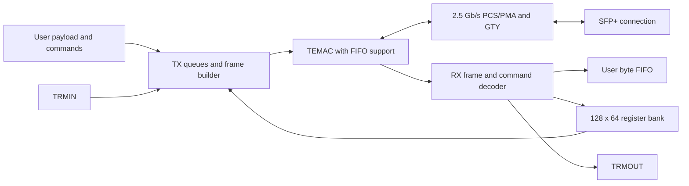

# 2.5 Gb/s Layer-2 Ethernet Core for Virtex UltraScale+

An FPGA Ethernet data-transfer core for a Virtex UltraScale+ board connected to an external peer through an SFP+ interface. The design combines a custom command and payload engine, a Tri-Mode Ethernet MAC, and a transceiver-based PCS/PMA configured for 2.5 Gb/s.

The project owner reports that the design has been tested on hardware. This repository preparation involved source and IP-configuration inspection only; no simulation, synthesis, implementation, or additional hardware test was performed.

**Repository scope:** this is a source and IP archive from an existing system. The shared VHDL packages, modified MAC support wrappers, board constraints, and original Vivado project are not included. See [integration requirements](docs/INTEGRATION.md) before attempting a build.

## Configuration found in the supplied files

| Item | Recorded configuration |
| --- | --- |
| Top-level entity | `axi_ethernet_0_top` |
| FPGA family | Virtex UltraScale+ |
| Device / package / speed / temperature | `xcvu9p` / `flga2104` / `-2` / `E` in the active Ethernet IP metadata |
| Intended Ethernet rate | 2.5 Gb/s |
| MAC | `tri_mode_ethernet_mac_internal`, Tri-Mode Ethernet MAC 9.0, `Data_Rate=2.5_Gbps`, internal interface |
| PCS/PMA | `gig_ethernet_pcs_pma_0`, PCS/PMA 17.0, `Standard=1000BASEX`, `MaxDataRate=2_5G` |
| Transceiver | GTY; the PCS metadata records location `X1Y52` |
| Differential reference clock | 156.25 MHz in the PCS configuration |
| Independent clock | PCS configuration records `DrpClkRate=100.0` MHz |
| PCS auto-negotiation / management | Disabled in the archived configuration |
| MAC-side application streams | 64-bit data, 8-bit keep, valid/ready/last |
| External transmit payload | 64 bits in the active packet engine; top-level width comes from `Bus_width` |
| External receive payload | 8-bit data, 12-bit FIFO count |
| Register bank | 128 entries of 64 bits in the active bridge |
| Main Ethernet IP generation metadata | Vivado 2025.2 |

These values describe the checked-in IP configuration. They do not identify the board model, SFP module, peer equipment, or measured payload throughput. SFP+ is the physical connection used by the system; the active core is configured for a 2.5 Gb/s BASE-X link. The presence of the unused `xxv_ethernet_1` archive does not select a 10/25 Gb/s datapath.

## Architecture



The transmit engine queues external payload commands, register-read responses, and terminal messages. It constructs custom Layer-2 frames and supplies the MAC FIFO through a 64-bit stream. The MAC connects to the PCS/PMA through an internal 8-bit GMII bus; the PCS/PMA drives the differential serial lane.

The receive engine checks the destination MAC address, extracts the application length and command fields, and routes data to the receive FIFO, the register bank, or the terminal output. Register reads produce responses through a separate transmit queue. This application path does not implement an IP, UDP, TCP, ARP, or DHCP stack.

## Repository layout

```text
HDL/                 Application RTL, top-level wrapper, and legacy helpers
IP/                  Vivado IP containers, XCI configurations, and support files
docs/INTEGRATION.md   Dependencies, interfaces, clock/reset behavior, build steps
docs/PROTOCOL.md      Frame fields, command routing, byte order, register behavior
docs/REVIEW.md        Scope of inspection and existing integration observations
README.md            Project overview and GitHub publication instructions
```

The original `constraints/`, `coe/`, and `Prj/` directories were empty when inspected. Git does not preserve empty directories. IP-local XDC files under `IP/` are not a replacement for the board pin and timing constraints.

| HDL file | Role |
| --- | --- |
| `axi_ethernet_0_top.vhd` | Active top-level interconnect, PCS/PMA, MAC FIFO wrapper, clocks/resets, application bridge |
| `ethernet_mac_RGMII_basic_pat_gen.vhd` | Active TX/RX and register bridge; its RGMII/pattern-generator name is historical |
| `tri_mode_ethernet_mac_v5_5_0_axi_pat_gen.vhd` | Command arbitration, payload queues, frame construction |
| `tri_mode_ethernet_mac_v5_5_0_rx.vhd` | Destination matching, frame decoding, receive FIFO and remote commands |
| `Config_Register_Comint.vhd` | Command/status register access and write-update strobes |
| `ethernet_mac_RGMII_syncer_level.vhd` | Three-stage control-level synchronizer; not the entity name instantiated by the top |
| `Double_Buffer_deck.vhd` | Legacy 8-to-32-bit buffering helper; outside the active TX path |
| `gtx_Comint.vhd` | Historical serial wrapper with commented-out core instances |
| `axi_ethernet_0_clocks_resets.v` | Legacy board clock helper; outside the active top-level hierarchy |

## User interfaces

| Group | Signals | Usage |
| --- | --- | --- |
| Serial lane | `sfp_txp/n`, `sfp_rxp/n` | Differential transceiver connection to the SFP+ path |
| Reference / support | `mgt_clk_p/n`, `independent_clock_bufg` | PCS reference and independent support clock |
| Resets | `glbl_rst`, `Soft_Reset`, `reset_error` | Global, application soft reset, and example-support checker reset input |
| TX payload | `wr_clk`, `wr_en`, `wr_data`, `wr_ready`, `wr_last` | Queued payload words; observe ready before writing; `wr_last` has no active framing use |
| TX command | `CMD_CODE`, `CMD_length`, `CMD_en` | Paired command and length sampled in `wr_clk` |
| RX payload | `rd_clk`, `rd_en`, `rd_data`, `rd_data_count` | Read the byte-wide asynchronous FIFO using its configured latency |
| RX notification | `rd_ready`, `data_len` | Receive-domain event and decoded length; synchronize/handshake into a different user clock domain |
| Terminal input | `TRMIN_clk`, `TRMIN_EN`, `TRMIN_Addr`, `TRMIN_Data` | Queue terminal-originated frames for transmission |
| Terminal output | `TRMOUT_clk`, `TRMOUT_EN`, `TRMOUT_Addr`, `TRMOUT_Data` | Decoded incoming terminal write |
| Register application | `command_registers`, `command_updates`, `status_registers`, `read_only_regs` | 128-entry register interface in the receive clock domain |
| MAC controls | `mac_speed`, `update_speed`, `config_board`, `pause_req_s` | Retained example-design controls; active limitations are documented separately |
| Status / clocks | `mmcm_locked_out`, `rxC156_25M_Clk_Comint`, speed and legacy diagnostic outputs | See the integration guide before using a status signal as a link/health indication |

Detailed timing and existing limitations are in [INTEGRATION.md](docs/INTEGRATION.md). The custom frame layout and command codes are in [PROTOCOL.md](docs/PROTOCOL.md).

## Using the design in Vivado

1. Restore the original shared packages and modified TEMAC example-support files listed in the integration guide. Use the versions from the tested system.
2. Open the original project, or create an RTL project for the actual board/device. The active IP metadata records `xcvu9p-flga2104-2-e`; confirm the board configuration before selecting the part.
3. Add the shared packages, required generated/custom support RTL, and active application VHDL. Set `axi_ethernet_0_top` as the top entity.
4. Import the required `.xcix`/`.xci` IP definitions and inspect the IP status. The active Ethernet containers record Vivado 2025.2; some auxiliary containers record other versions. Preserve the tested IP configuration when resolving versions.
5. Restore the board constraints, including the reference clock, support clock, transceiver location, pin mapping, and clock-domain constraints. Add the enclosing system logic that supplies payload, command, status, and terminal interfaces.
6. Follow the original implementation and board-programming flow. This repository does not supply a verified standalone build script, bitstream, or host application.

No simulation is required for the documentation/comment changes in this revision. Reproducing a hardware build requires the missing original integration files.

## Preparing a GitHub repository

The `.gitignore` excludes local Vivado caches, lock files, run directories, logs, checkpoints, and generated simulation netlists. IP configuration containers remain versioned because they preserve the supplied configuration. `.gitattributes` treats `.xcix` as binary archives.

After creating an empty repository in your GitHub account, run the following in this repository, replacing the URL with your own:

```powershell
git status
git branch -M main
git remote add origin https://github.com/YOUR_USERNAME/YOUR_REPOSITORY.git
git push -u origin main
```

The local documentation commit does not publish anything to GitHub. No GitHub destination was provided with this source snapshot.

## Source notices

Several supplied HDL and generated IP files contain Xilinx copyright and license notices; those notices have been preserved. No project-wide open-source license has been selected in this repository. The supplied vendor IP and example-derived files retain their existing terms; this README does not assign them a new license.
